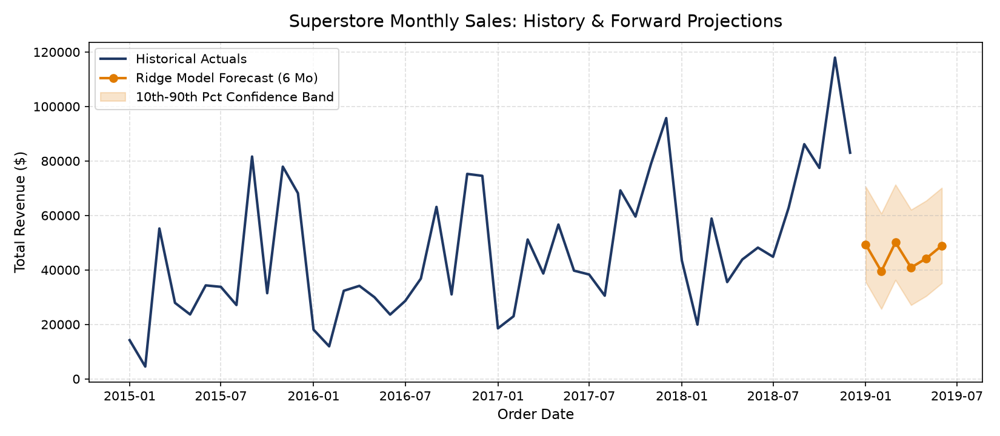
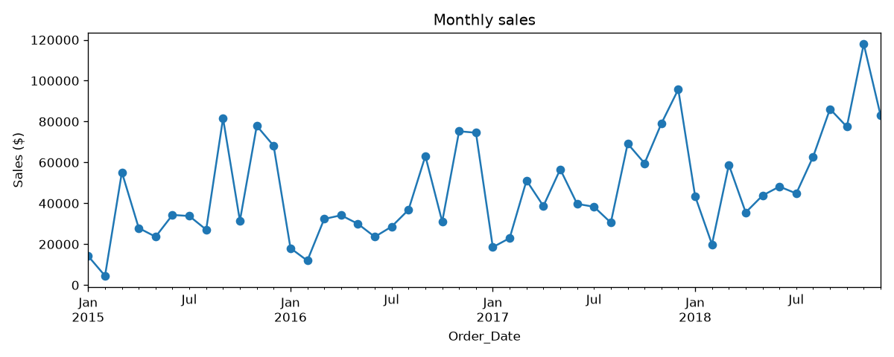
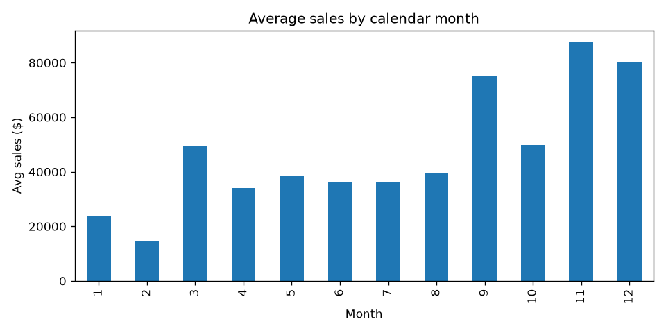
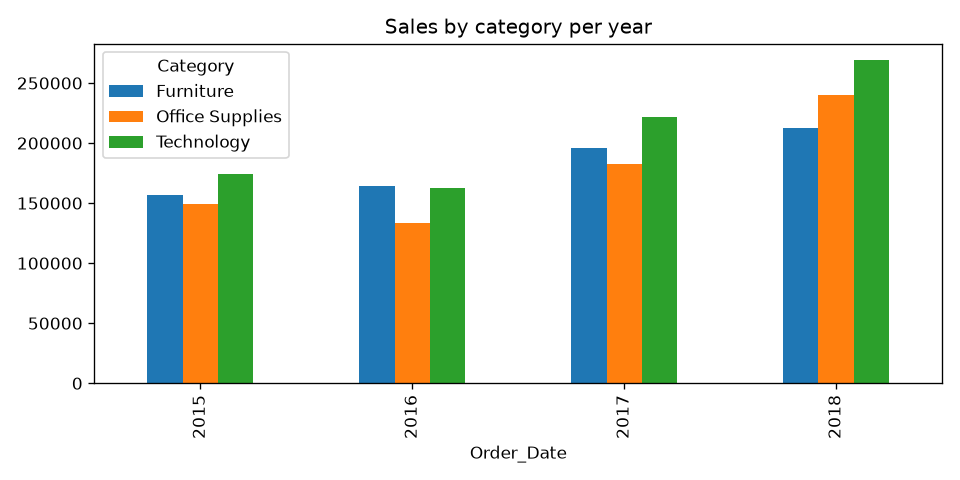

# 📈 Superstore Monthly Sales Forecasting

[](https://www.python.org/)
[](https://streamlit.io/)
[](https://scikit-learn.org/)
[](https://xgboost.readthedocs.io/)
[]()

An end-to-end retail demand forecasting system and interactive web application built on 4 years (2015–2018) of Superstore transactional data. The project provides reliable multi-step forward revenue projections with empirical uncertainty bounds, validated using rolling walk-forward backtesting.

---

## 🌟 Visual Showcase

### 1. Forward Projections with Empirical Confidence Intervals
The model generates recursive monthly revenue forecasts. The shaded band captures historical 10th and 90th percentile backtest error residuals to quantify upside and downside risk:



---

### 2. Historical Monthly Sales Trend (2015 – 2018)
Historical demand demonstrates steady year-over-year expansion coupled with pronounced holiday surges:



---

### 3. Seasonality Profile Across Calendar Months
Average sales across the 48 months reveal a distinct annual cycle: a post-holiday trough in January and February followed by a significant peak in November and December:



---

### 4. Product Category Breakdown Across Years
Technology, Furniture, and Office Supplies contribute consistently to total revenue across all operating years:



---

## 🏗️ Project Architecture & Directory Structure

```text
superstore-forecasting/
├── data/
│   ├── raw/
│   │   └── superstore.csv                   # Original transactional CSV (read-only)
│   └── processed/
│       └── superstore_clean.csv             # Cleaned, validated, and time-ordered data
├── notebooks/
│   └── 01_exploratory_data_analysis.ipynb   # Step 2: Interactive EDA & correlation analysis
├── src/
│   ├── __init__.py                          # Package initialization
│   ├── data_loader.py                       # Step 1: Ingestion, schema typing & cleaning
│   ├── explore.py                           # Step 2: Visualizations & figure generation
│   ├── features.py                          # Step 3a: Lag & rolling window feature creation
│   ├── baseline.py                          # Step 3b: Naive & seasonal benchmark scores
│   ├── metrics.py                           # Scoring engine (MAE, RMSE, MAPE)
│   ├── models.py                            # Model registry (Ridge, Random Forest, XGBoost)
│   ├── walk_forward.py                      # Step 5: 18-month rolling walk-forward evaluation
│   ├── train.py                             # Step 4 + 6a: Production training & model export
│   └── forecast.py                          # Recursive multi-step auto-regressive inference
├── models/
│   └── best_model.joblib                    # Serialized production bundle (model + bounds)
├── reports/
│   └── figures/                             # Generated publication-quality charts
├── app/
│   └── streamlit_app.py                     # Step 6b: Interactive Streamlit web application
└── requirements.txt                         # Pinned project dependencies
```

---

## 🔬 End-to-End Pipeline & Methodology

### Step 1: Ingestion & Data Hygiene (`src/data_loader.py`)
- Reads the raw transactional dataset with proper character encoding (`latin-1`).
- Parses dates (`Order_Date`, `Ship_Date`) with day-first ordering.
- Standardizes geographic identifiers (`Postal_Code` typed as a string without trailing decimals).
- Removes duplicate transactions and sorts chronologically.
- Exports cleaned data to `data/processed/superstore_clean.csv` (9,800 records).

### Step 2: Exploratory Data Analysis (`notebooks/` & `src/explore.py`)
- Resamples transactions into monthly revenue series (`MS` frequency).
- Identifies year-over-year growth and seasonal recurring troughs and spikes.
- Confirms strong seasonal autocorrelation at 12-month intervals.

### Step 3: Feature Engineering (`src/features.py`)
Because time series cannot use random train/test splits, time-aware feature representations are engineered:
- **Calendar Signals**: `month` (1–12), `quarter` (1–4)
- **Autoregressive Lags**: `lag_1`, `lag_2`, `lag_3` (recent momentum)
- **Seasonal Lag**: `lag_12` (captures same-month performance from the previous year)
- **Rolling Window Summary**: `roll_mean_3` (3-month moving average of past sales)

### Step 4: Baseline Benchmarks (`src/baseline.py`)
Any complex machine learning model must prove its value against domain baselines:
1. **Training Mean**: Predicts the overall historical mean.
2. **Naive (Last Month)**: Assumes sales will equal the previous month.
3. **Seasonal Naive (Same Month Last Year)**: Assumes sales will equal the same month in the prior year.

### Step 5: Rolling Walk-Forward Backtesting (`src/walk_forward.py`)
Instead of a single arbitrary train/test split, models are evaluated across an **18-month rolling walk-forward window**:
1. Train on history prior to month $T$ (starting at $T \ge 18$).
2. Predict month $T$.
3. Advance $T \to T + 1$ and repeat through the end of the dataset.
4. Calculate aggregate Mean Absolute Error (MAE), Root Mean Squared Error (RMSE), and Mean Absolute Percentage Error (MAPE).

### Step 6: Production Training & Serialization (`src/train.py`)
- Selects the champion model based on walk-forward MAE.
- Calculates empirical 10th and 90th percentile forecast error bounds.
- Refits the champion model across the complete 48-month history to capture all recent patterns.
- Serializes model pipeline, feature lists, and error bounds into `models/best_model.joblib`.

### Step 7: Recursive Multi-Step Forecasting (`src/forecast.py`)
- Forecasts 1 to 12 months ahead dynamically.
- For multi-step horizons, each predicted month feeds forward into subsequent lag calculations (`lag_1`, `roll_mean_3`).
- Attaches asymmetric upper and lower prediction intervals based on backtest residuals.

### Step 8: Interactive Dashboard (`app/streamlit_app.py`)
- A rich web interface with forecast horizon sliders, interactive KPI cards, tabbed analytics, and one-click CSV data export.

---

## 🏆 Model Performance & Evaluation Scoreboard

Evaluated across **18 walk-forward test periods** (July 2017 – December 2018):

| Model Architecture | MAE ($) | RMSE ($) | MAPE (%) | Validation Result |
| :--- | :---: | :---: | :---: | :--- |
| **Ridge (Linear with L2 Penalty)** | **13,759.0** | **16,669.0** | **23.3%** | 🥇 **Selected (Champion)** |
| **Random Forest Regressor** | 14,492.0 | 16,502.0 | 25.9% | 🥈 Competitive |
| **Seasonal Naive (Same Month Last Year)** | 14,498.0 | 17,876.0 | 23.8% | 🥉 Strong Baseline |
| **XGBoost Regressor** | 16,023.0 | 18,200.0 | 30.6% | Overfit on Small Sample |
| **Naive (Last Month)** | 20,729.0 | 25,335.0 | 38.5% | Weak Baseline |

### 💡 Why Ridge Outperformed Gradient Boosting (XGBoost)
- **Sample Size Dynamics**: The monthly aggregated dataset contains 48 total time steps. Complex non-linear tree ensembles (like XGBoost) easily overfit random monthly fluctuations when training on small sample sizes.
- **Regularization & Linearity**: Ridge regression applies an L2 penalty ($\alpha = 10.0$) alongside feature standard scaling. It smoothly combines the linear upward trend with the dominant 12-month seasonal lag without suffering variance blow-up.

---

## 🛠️ Technology Stack & Libraries

### Core Data & Machine Learning
- **[Python](https://www.python.org/)** (v3.10+): Primary programming runtime.
- **[Pandas](https://pandas.pydata.org/)**: Resampling, time-indexing, tabular manipulation, and feature engineering.
- **[NumPy](https://numpy.org/)**: Vectorized mathematical operations and residual metrics calculation.
- **[Scikit-Learn](https://scikit-learn.org/)**: Ridge regression, Random Forest, data preprocessing pipelines (`StandardScaler`, `make_pipeline`).
- **[XGBoost](https://xgboost.readthedocs.io/)**: Gradient boosted tree benchmarking.
- **[Joblib](https://joblib.readthedocs.io/)**: Lightweight model persistence and bundle serialization.

### Visualization & User Interface
- **[Streamlit](https://streamlit.io/)**: Interactive reactive web dashboard.
- **[Matplotlib](https://matplotlib.org/)**: Plotting engine for static reports and dashboard time-series visuals.
- **[Seaborn](https://seaborn.pydata.org/)**: Statistical data visualization and correlation heatmaps.

### Development & Tooling
- **[JupyterLab / Notebook](https://jupyter.org/)**: Interactive exploration and documentation.
- **[Pytest](https://docs.pytest.org/)**: Code verification and test execution.

---

## 🚀 Quickstart & Setup Guide

### 1. Clone & Navigate to Repository
```bash
git clone https://github.com/your-username/superstore-forecasting.git
cd superstore-forecasting
```

### 2. Set Up Virtual Environment
```bash
# Windows (PowerShell)
python -m venv .venv
.venv\Scripts\Activate.ps1

# macOS / Linux
python3 -m venv .venv
source .venv/bin/activate
```

### 3. Install Dependencies
```bash
pip install -r requirements.txt
```

---

## 💻 Running the Modules

Execute any stage of the pipeline independently from the root directory:

```bash
# 1. Ingest and clean raw data
python -m src.data_loader

# 2. Generate and save exploratory figures
python -m src.explore

# 3. Inspect engineered features and split periods
python -m src.features

# 4. Evaluate naive baselines
python -m src.baseline

# 5. Run rolling 18-month walk-forward validation
python -m src.walk_forward

# 6. Train best model, compute error bands, and save bundle
python -m src.train

# 7. Launch the Streamlit dashboard
streamlit run app/streamlit_app.py
```

---

## 🖥️ Using the Streamlit Dashboard

Once launched, visit **`http://localhost:8501`** in your browser:

1. **Forecast Horizon Slider**: Choose between 1 and 12 forward months.
2. **Key Metric Cards**: View total historical revenue, monthly historical averages, projected period revenue, and predicted peak sales month.
3. **Tab 1: Forecast & Projections**:
   - High-resolution chart depicting actual historical sales, forecast trajectories, and 10th–90th percentile prediction bands.
   - Clean tabular output with lower/upper boundaries.
   - **Download Forecast as CSV** button to export forecast numbers directly into Excel/BI tools.
4. **Tab 2: Seasonality & Exploration**:
   - Monthly average sales distribution highlighting recurring Q4 holiday demand.
   - Categorical and regional revenue share breakdowns.
5. **Tab 3: Model Evaluation**:
   - Full scoreboard showing walk-forward cross-validation performance across all tested models.

---

## 🔮 Future Roadmap

- [ ] **Hierarchical Forecasting**: Implement reconciliation algorithms (e.g., MinT / Bottom-Up) to forecast at the Category, Sub-Category, and Regional level simultaneously.
- [ ] **Statistical & Bayesian Models**: Add SARIMAX with exogenous calendar variables and Bayesian Prophet modeling for decomposable holiday analysis.
- [ ] **Automated CI/CD**: Dockerize the application and set up automated unit testing pipelines on GitHub Actions for automated deployment to Google Cloud Run or AWS ECS.

---

## 📄 License
This project is licensed under the [MIT License](LICENSE).

